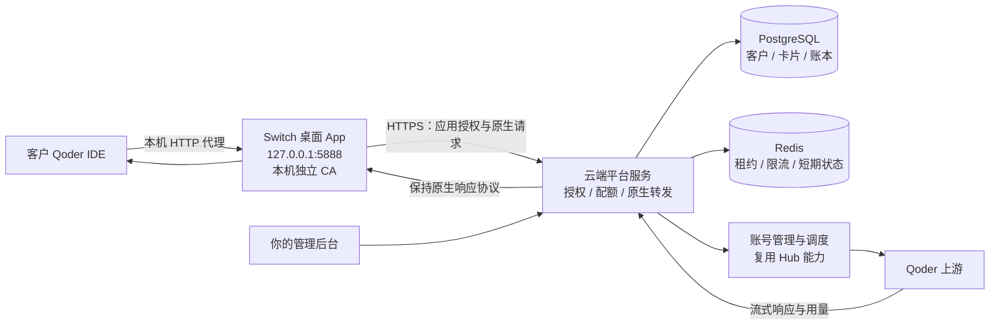

# 云端 Qoder 号池与激活码桌面客户端实施方案

日期：2026-10-27。状态：源码评估与实施设计，尚未完成官方 IDE 到云端号池的真实协议验证。

本方案对应的产品目标：你在后台生成固定额度的激活码，客户安装 Windows 桌面 App、输入激活码；App 完成证书初始化和本地代理启动，客户在受支持的 Qoder 客户端网络设置里填写 HTTP 代理地址即可使用。上游账号、Token、换号与额度裁决全部在云端。客户无需自己维护 Qoder 账号池。

## 1. 选型结论

采用 **Qoder Switch 作为桌面端基础，Qoder2API-Hub 作为云端账号与协议能力的来源，新增客户授权、额度账本和原生协议转发层**。

不能直接把 Hub 的 API 地址填写成 IDE 的 HTTP 代理地址。Hub 目前接受 OpenAI / Responses / Anthropic API 请求，Switch 接收的是 IDE 的 HTTP CONNECT 与原生 HTTPS 请求。两者之间缺少原生协议桥接，这是主要开发内容。

| 能力 | 当前 Switch | Qoder2API-Hub | 最终取舍 |
|---|---|---|---|
| Windows 桌面窗口、托盘、安装包 | 已有 Tauri / NSIS 配置 | Web 管理界面与启动脚本 | 复用 Switch |
| 本机 HTTP 代理、HTTPS 解密 | 已有 Hudsucker 与本机 CA 代码 | 没有 HTTP CONNECT 处理器 | 复用并修复 Switch |
| 证书安装 | 已有当前 Windows 用户 Root 安装代码 | 无对应桌面能力 | 复用并加强 Switch |
| 云端多账号与凭据生命周期 | 主要为本机 Token 池 | OAuth、PAT、Token 刷新、双区、调度、冷却 | 优先复用 Hub 账号与协议模块 |
| IDE 原生请求透明转发 | 本机直接向上游签名转发 | 当前入口是兼容 API | 新做云端原生转发适配器 |
| 账号用量观测 | 简单请求计数、日志和配额查询 | Credits、Token、账号 / Key 统计 | 复用 Hub 解析思路；生产账本另做 |
| 客户激活码、设备绑定、月卡 | 未见完整实现 | 未见完整实现 | 新增平台模块 |
| 多客户额度隔离、原子扣费 | 无 | 已有限额主要针对上游账号 | 新增 PostgreSQL 账本 |
| 截图中的客户界面 | 需要改版 | 管理员看板，不是客户 App | 在 Switch 中实现 |

评估快照：Switch `934be4e0bc834ac3fc0bba97d83b02bacb06fb10`；Hub `908f3dbc4e66bb35d01fab4ba21db334771e7e06`；Autopilot `299109f750c9dff723e0c46283a4b70135d68d18`。这三个标识用于固定本次评估依据，不代表未来版本兼容承诺。

## 2. 首发边界与交付前提

首发支持 Windows 10/11 x64、一个经实测确认的 Qoder IDE 国际版版本、一个区域，以及一组经过验证的模型和操作。安装包应记录兼容版本范围。QoderWork、插件、CLI、国内版按独立适配项目验收，不因界面有开关就宣称已支持。

第一版默认：一码一份额度权益、绑定一台设备、同一客户最多一个进行中的计费请求；允许串行切换上游账号。后台可以为特定套餐放宽设备数和并发数，但必须先经过并发计费测试。

“云端号池”表示存量账号在服务器统一导入、维护与调度；系统本身不会创造可消费额度。首发通过管理员浏览器 OAuth / PAT / 凭据导入准备账号资源。Autopilot 可以作为以后可选的运维导入来源，不是首发系统持续供给账号或额度的前提，也不下发给客户运行。

Hub 的 LICENSE 是 MIT；其 README 同时将项目定位为个人私有环境下使用有授权的账号，并明确反对商业转售。代码复用与上游账号的共享、转售权限是两件事；面向客户上线前，需要落实符合实际服务授权的账号来源与使用方式。本方案不把 MIT 许可证视为上游账号转售许可。

## 3. 先完成四项协议验证

这一阶段使用管理员提供的少量测试账号，以及两台隔离的 Windows 测试环境；不先开发完整商城或大批量注册工具。

| 验证项 | 怎么验证 | 通过标准 | 不通过时如何处理 |
|---|---|---|---|
| 无官方账号的客户初始化 | 干净安装受支持 IDE，只安装 App、激活、设代理，观察登录与会话启动 | IDE 能发起正常对话，客户不必另有上游账号 | 查明是否能通过明确的会话 / 用户信息适配完成初始化；若不能，必须说明需要首次官方登录，不能冒充满足原目标 |
| 证书与代理信任 | 测试系统根证书、IDE 实际信任链、CONNECT、HTTP/2、证书固定行为 | 客户仅设置 HTTP 代理即可；不需关闭 TLS 校验 | 做可恢复的应用级证书信任适配；若目标版本仍不能信任，排除该版本 |
| 原生协议闭环 | 逐项验证模型列表、普通对话、多轮、工具调用、取消、长上下文与流式响应 | 经过云端选号与签名后行为正确、首字及时返回、会话连续 | 根据原始协议实现适配；不可强行套成 OpenAI 请求而丢失 IDE 语义 |
| 单次用量来源 | 记录原生响应中的 usage / credits / 上游请求 ID，与官方记录交叉核对 | 每笔可归属、可去重、区分缺失与真实 0 的用量 | 暂停按官方 Credits 销售该链路；若改为平台按次 / Token 套餐，必须明确改变套餐口径 |

需要额外形成“路由清单”：域名、路径、方法、协议、用途、是否计费、身份字段、流式类型、错误码以及相应测试。现有 Switch 只配置两个目标域名，不能据此推定覆盖新版 IDE 的所有流量。

Hub 的现有 `_extract_usage()` 会把缺少 Credits 字段的情况归为 0；商业账本必须保留字段存在性与来源，不能沿用这个默认值当成免费调用。原生流量是否提供相同字段，以本阶段实测为准。

如果四项验证通过，才进入下面的正式开发。若其中一项失败，先输出具体差异和可验证替代流程，更新产品承诺与计划。

## 4. 最终系统结构



客户端只持有设备密钥、平台登录会话和展示缓存；上游账号密码、Access Token、Refresh Token 只在服务器。不能继续沿用当前“把账号池 Token 拉到本机”的 `fetch_pool_account` 作为客户接入方式，否则客户可以绕过平台扣费直接用上游凭据。

首发把云端控制面与原生网关放进一个服务代码库，使用 Python 3.12、FastAPI、异步 HTTP 传输、PostgreSQL、Redis；抽取 Hub 的账号、认证、调度和用量模块，通过明确接口接入。原有 Hub HTTP 处理层和文件统计不会直接充当客户授权与结算系统。同步的 Hub 调用放到受限线程池或后台任务，不能阻塞异步流转发。

初期只运行一个账号池所有者进程，每个上游账号只由它负责刷新与派发；服务扩容前再拆分账号服务与共享租约。不能把多个原版 Hub 进程挂到同一组 JSON 文件上当成集群。Redis 保存短期协调状态，PostgreSQL 是权益和额度的唯一事实来源。

管理员入口和客户入口分开鉴权。后台面板、账号导出、上游凭据管理都不直接暴露给客户 App。Hub 的全局 API Key 和面板会话不能下发给客户。

## 5. 客户实际操作流程

1. 客户已安装兼容的 Qoder IDE，下载安装我们的 App。
2. 首次启动展示简短的证书用途说明，客户选择“初始化并开始”。
3. App 先生成本机独立 CA 和私钥，再安装当前用户信任证书，检查实际信任状态。
4. 客户输入你发给他的激活码。云端创建 / 恢复该设备的客户身份，原子兑换对应权益。
5. App 自动启动 `127.0.0.1:5888`，显示代理地址和一键复制按钮。
6. 客户在 Qoder 的网络设置中填写 `http://127.0.0.1:5888`。不要求改模型 API Base URL。
7. App 自动进行连接诊断，分别显示“本机代理、证书信任、云端授权、模型请求”状态。
8. 使用时云端选择账号并扣除客户卡片额度，App 展示剩余量和明细。
9. 额度耗尽、权益到期或授权被冻结时，云端拒绝新的计费请求，App 给出明确提示。
10. 退出代理后提醒 IDE 当前配置仍指向本机端口；安全证书页提供检查、修复、卸载证书。

证书写入以当前 Windows 用户为范围，不要求通过关闭系统防护或 TLS 校验实现。若系统策略禁止写入，App 必须报告失败并提供明确的人工处理入口，不能显示假成功。操作系统或安全软件出现提示时仍由用户确认。

证书私钥只在本机保存，使用 Windows DPAPI / 受限文件权限保护；每台设备独立生成，不能在安装包中放同一份全局 CA 私钥。安装、检查、卸载按本机证书指纹匹配，不能仅按名称模糊删除。新数据目录改为产品专属目录，避开官方 Qoder 的用户数据路径。

## 6. 原生代理请求怎样经过云端

每笔受支持请求的流程固定如下：

```text
IDE 请求
→ 本机 CONNECT / TLS
→ 识别已验证的域名和路径
→ 为本次请求分配稳定 request_id
→ 使用平台设备会话，经 HTTPS 发给云端
→ 云端验证客户、卡片、设备、并发和模型权限
→ PostgreSQL 事务预留额度
→ 获取上游账号租约，按客户与会话进行路由
→ 云端生成正确的上游认证并转发原始协议
→ 按原生格式持续把响应流返回 IDE
→ 云端提取真实用量，幂等结算，释放剩余预留
→ App 更新卡片和请求明细
```

客户端到云端使用平台自己的认证；原 IDE 凭据不作为客户身份或权益依据。云端按已经验证的路由映射恢复目标主机、方法和路径，不接受任意目标 URL。云端签名针对实际转发的请求字节和路径生成，不直接套用 `build_qoder_body()` 重新拼接 IDE 提示词。

原生二进制、压缩、SSE / 分块响应分别按实际协议处理。取用量时复制一份流做增量解析，不先收集完整回复再返回。取消请求要传播到云端；云端应按上游实际完成情况继续结算，不能把客户断开连接等同于上游免费。

目标域名和路由由签名配置发布；非目标域名使用 CONNECT 隧道直接通行，不解密、不采集正文。已识别为受控上游的流量在云端不可用时关闭计费通道，不自动降级成使用上游 Token 直连。未知的目标域名 / 路由要提示兼容性问题，不能假装已经代理成功。

重试仅在协议允许、能判断上游尚未执行的情况下进行。已开始输出流，或上游是否执行无法确定时，不自动换号重放，以免多扣费、重复工具调用。业务拒绝、身份失效、排队、模型权限不足分别处理，不能把所有 403 都当作换号信号。

## 7. 激活码、卡片与固定额度

采用“激活码兑换权益”的模型，不把激活码直接当作可无限复用的网关 API Key。

首发套餐示例：

| 属性 | 示例值 |
|---|---|
| 套餐名称 | VIP-3000 月卡 |
| 发放额度 | 3000 平台 Credits |
| 有效期 | 首次成功激活起 30 天 |
| 可绑定设备 | 1 台 |
| 客户同时进行的计费请求 | 1 个 |
| 区域与模型 | 后台套餐明确指定 |
| 超额策略 | 不允许客户余额为负；余额不足拒绝新请求 |
| 到期策略 | 未使用额度到期失效；不隐含滚存 |
| 再次购买 | 新码兑换新卡，各卡额度和到期日分别记录 |

平台 Credits 是客户在我们系统中的权益单位，不是某一个上游账号的余额。主方案按“服务端取得的本次上游真实 Credits × 套餐固定倍率”扣除，首发倍率设为 1；倍率版本在请求准入时固定，不能在请求结束后临时涨价。

如果实际链路不能提供可信的单次 Credits，这个主方案暂不成立：不能用上游账号共享余额的前后差来分摊多客户账单，也不能用截图中的数字或 Hub 的 OpenRouter 等价花费估算代替。要么先补齐可归属用量，要么另行明确采用按次 / Token 的平台套餐，再重新确定定价和展示文案。

卡片展示例：总量 3000、已用 1817、剩余 1183、有效期截止时间。余额计算和服务器时间均来自云端；本地改时钟、改 JSON、改 UI、重复刷新都不会增加额度。

激活码由后台用足够随机性的生成器产生，服务端保存摘要及所属批次，不在普通日志中保存明文。重复兑换同一码、同一客户与设备时返回原权益；其他设备重放不能再领额度。兑换本身有独立幂等记录和数据库唯一约束。

客户身份使用本机生成的设备密钥对和服务端记录。兑换成功后签发短期平台访问凭证及可轮换续期凭证，密钥用 DPAPI 保护。换机和重装通过后台解绑 / 恢复同一客户权益处理，不能重新发一份重复额度。第一版不要求客户再注册用户名密码。

多张卡可同时存在；按先到期先消费。卡片在请求执行中到期时，以准入时已锁定的预算完成该笔结算；释放的未使用部分按该卡实际到期状态处理，不能释放成新的可用余额。

## 8. 账本与超额控制

以整数微积分记账，例如 1 Credit = 1,000,000 单位；从十进制字符串解析用量，不用浮点数累计客户余额。

每笔请求持久化这些关联：客户、设备、权益卡、request_id、请求摘要、上游账号、路由 / 区域 / 模型、定价版本、用量来源、执行状态、结算状态。客户身份、设备和上游账号不是同一个 ID。

事务流程：

1. 验证请求后锁定可用卡片，检查有效期与并发，预留本次预算并写请求状态；成功提交后才发上游请求。
2. 预算存在可信上界时按上界预留。首发单并发情况下，无法算出可靠上界则锁定该卡本次可用余额，并采用保守的模型 / 输出上限。
3. 接收用量后写不可变的用量回执，在同一事务里结算并释放未使用预留。
4. 确认上游未执行的失败释放预留；已可能消费但用量缺失的请求进入待核对状态，不能直接按 0 结算。
5. 待核对请求限制后续计费准入，后台通过上游记录 / 回执核对；明确不可确认时走有记录的补偿政策，而非永久静默冻结。
6. 每个请求最多形成一笔最终结算；同一幂等键携带不同请求摘要直接拒绝。重复提交进行中的请求不能再次发往上游。

请求状态示例：`admitted → reserved → dispatched → streaming → settled`；异常进入 `failed_unstarted` 或 `usage_pending`。进程在发送上游后崩溃，不能仅因租约超时就把预留全退；重启恢复任务须检查持久化请求和回执。

数据库不可用时拒绝新的计费请求。已执行的请求保留持久化的准入记录；结算回执采用可恢复写入 / 重试队列，不能依赖进程内存、Redis 或扫描 JSONL 来保证钱账正确。

客户最大扣费不能超过已获权益余额。但如果上游直到回复结束才报告 Credits，且单次成本无法获得可信上界，技术上不能保证“上游消费绝不超过最后一点客户余额”。这种尾部差额由平台承担或通过经验证的输出上限控制，不能事后让客户余额为负。商业前需要在长输出场景验证这个成本边界。

## 9. 云端号池的运行规则

账号来源优先是已经具备可使用额度和模型权限的账号，通过管理员 OAuth / PAT / 经校验凭据导入。导入时读取真实用户身份、凭据有效期、区域、可用模型和额度来源；检测失败的账号不加入可派发池。

账号状态包括 `ready / refreshing / cooldown / exhausted / reauth_required / disabled`。调度需要满足区域、模型权限、账号余额、并发与冷却条件；同一客户同一对话保持账号亲和，不把一个公共会话 ID 复用给不同客户。

同一账号的刷新使用互斥 / 租约，不能有多个进程同时轮换 Refresh Token。上游账号凭据以服务器密钥加密保存，密钥与数据库备份分开；客户接口不提供上游 Token 导出。凭据到期不以定时刷新“必然可用”为假设，刷新失败需转重新授权。

每个账号设置并发上限，容量不足时排队或明确拒绝；池中账号数不是可承诺并发数。只有在前一个请求允许结束或上游状态明确时才重新派发租约。账号余额属于资源调度数据，不能用它代替客户卡片余额。

管理员可看到号池健康、将到期账号、可用模型、凭据刷新失败、已冻结账号和总资源变化。自动开户 / 领取活动不是平台可用性与客户额度的依赖条件。

## 10. 数据模型与接口边界

| 表 / 记录 | 用途 |
|---|---|
| customers | 客户主体、状态、后台备注 |
| devices | 设备公钥、绑定、会话版本、吊销 |
| plans / plan_versions | 套餐规则、额度、有效期、模型和并发 |
| activation_batches / activation_codes | 发码批次、码摘要、兑换归属与状态 |
| entitlements | 每张卡的发放、已用、预留、到期与可用额度 |
| requests | 幂等请求、准入预算、执行和结算状态 |
| usage_receipts | 可信上游用量、来源、模型、Token、Credits |
| quota_ledger | 发放、预留、结算、释放、到期、撤销、补偿流水 |
| upstream_accounts | 加密凭据引用、区域、账号健康与权限 |
| audit_events / outbox | 后台审计、可靠事件与恢复任务 |
| announcements / releases | 公告、客户端兼容策略、签名发布 |

所有客户查询都由服务端会话确定客户 ID，不相信客户端任意提交的 customer_id。更新余额必须经过账本事务，后台人工补额度也写补偿流水。管理员审计记录操作者、原因、旧值与新值，业务日志默认不保存聊天正文、Authorization 或验证码。

客户接口首版包含：设备挑战与会话续期、激活兑换、权益与余额、分页用量、公告、客户端配置、兼容性诊断，以及单一受控原生转发入口。

管理员接口包含：套餐版本、发码与导出、激活查询、设备解绑、客户冻结、账本调整、上游账号导入 / 授权 / 刷新、待核对请求处理、公告与版本发布。

原生转发入口使用服务端路由 ID，例如 `POST /client/v1/relay/{route_id}`，附平台鉴权、请求 ID 和经校验的原始方法 / 查询 / 头 / 内容。只允许已登记的路由，不提供任意 HTTP 代理或任意 URL 抓取能力。实际封装方式在协议验证后按流量类型固定。

## 11. 按截图实现客户 App

桌面端保留 Vue 3 + Tauri，改成黑底金色、顶部页签、左侧卡片区与右侧用量明细。首发两个页签：“总览”“安全证书”。

| 截图区域 | 我们的行为 |
|---|---|
| 产品名、版本、在线灯 | 显示自有品牌、客户端版本、云端连接和授权状态 |
| 当前账号 / 线路 | 显示线路别名或脱敏信息；不展示上游凭据 |
| 自动换号、阈值 | 云端执行调度；客户只能在套餐允许范围内设置偏好 |
| Qoder IDE / QoderWork / CLI 等开关 | 仅开放已验收适配器，未支持的置灰说明 |
| 检测按钮 | 显示连接、路由、模型可用性等可核验结果；未能验证模型真实身份时不宣称能检测隐藏降级 |
| 激活码输入和激活 | 兑换权益；可查看失败原因与重试结果 |
| 月卡 | 套餐名、状态、总量、已用 / 剩余、进度、精确到期时间 |
| 右侧明细 | 时间、平台 Credits、实测模型、输入 / 输出 / 缓存 Token、状态；待核对时明确标记 |
| 公告 | 后台维护，客户端只读获取 |
| 安全证书 | 本机 CA 指纹、安装与信任检查、修复、卸载、代理诊断 |

页面所有金额、额度和有效期使用服务器返回值，刷新不会改变账本。首版每 5–10 秒刷新轻量展示数据；请求结算后可立即推送或触发刷新。客户页面不轮询上游账号余额，也不能直接访问 Hub 的管理员看板。

## 12. 当前 Switch 的具体改造范围

| 当前位置 | 必须修改的内容 |
|---|---|
| `src-tauri/src/proxy/handler.rs` | 客户端不再持有上游 Token 或本地签上游请求；改走云端原生转发。移除完整收集响应后返回的做法；处理流式与取消 |
| `src-tauri/src/proxy/server.rs` | 按每笔请求保存独立关联上下文，不能用共享的最后请求 ID / 最后目标标记关联并发响应 |
| `src-tauri/src/commands/proxy_cmd.rs` | 拆分证书生成和启动流程；初始化、安装、信任验证和重复启动须幂等 |
| `src-tauri/src/proxy/cert.rs` | 每设备独立 CA；按指纹校验与卸载；明确安装失败；保护私钥 |
| `src-tauri/src/state.rs`、`config.rs` | 产品独立数据目录、平台会话、线路配置、诊断与升级状态 |
| `src-tauri/src/logger.rs` | 生产默认不保存 Authorization 与正文；日志不是账本 |
| `src-tauri/src/commands/account_cmd.rs` | 客户发行版移除远程领取原始上游 Token 的入口，换成激活与权益接口 |
| `src/stores/app.ts`、`src/types.ts` | 新增设备、激活、卡片、余额、账单、证书诊断的数据类型与状态 |
| `src/App.vue`、`src/components/*` | 按截图改版；把本机账号池管理移到管理员后台 |
| `src-tauri/tauri.conf.json`、构建流程 | 产品名、版本、NSIS、安装 / 卸载清理、签名更新与兼容版本管理 |

当前代码中，证书在启动代理时才生成，而安装证书入口要求证书已存在；初始化顺序需要修复。响应处理中 `body.collect()` 会等全部内容到齐后再返回，不能当作已经具备合格的实时流式体验。当前响应关联和 401/403 换号规则也必须重新验证。

## 13. 部署与运维

首发使用一台 Linux 云主机做小规模验证，Docker Compose 启动 HTTPS 入口、平台服务、PostgreSQL、Redis 和后台任务；容量根据真实长连接压测决定，不按账号数量猜并发。生产固定经过验证的代码提交和镜像摘要，不跟随 `latest` 自动升级。

外部只开放 HTTPS 客户入口；管理后台增加独立认证和入口限制。数据库、Redis、账号文件与内部服务端口不公开。配置域名与 TLS，验证 SSE 不被反向代理缓冲，设置连接、正文和长请求超时上限。

持续观测：可用账号数、实际并发、排队、429 / 认证失败、首字延迟、流中断、用量缺失、预留滞留、激活失败和账本异常。额度数据库故障、账号池耗尽、上游整体异常要有独立告警。

数据库与加密凭据定时备份，并进行恢复演练；恢复后需要检查未结算请求与已兑换激活码，不能回滚出可二次兑换的额度。后台提供维护模式：停止新准入，等待或记录进行中请求，再升级。

## 14. 开发阶段、依赖与交付物

下表是单人开发的初步工作量范围，按工作日计算，不含上游授权、外部账号准备和无法控制的协议变更等待。先完成 P0，再根据实际抓取到的协议修订后续估算。

| 阶段 | 预计工作日 | 交付物 | 退出条件 |
|---|---:|---|---|
| P0 协议与计费验证 | 3–5 | Windows 实测记录、路由清单、用量样本、兼容版本表 | 第 3 节四项成立；否则先修订产品范围 |
| P1 云端原生转发与号池 | 5–8 | Hub 模块适配、原生网关、账号状态与租约、流式与会话测试 | 测试客户通过本机代理使用云端账号，客户端无上游凭据 |
| P2 激活码与额度账本 | 5–8 | 设备会话、套餐、卡片、原子预留 / 结算、恢复任务 | 重放、并发、耗尽、到期、崩溃恢复测试通过 |
| P3 客户 App 与证书 | 5–8 | 截图风格 UI、激活 / 卡片 / 用量、初始化与诊断 | 干净 Windows 设备完成目标用户流程 |
| P4 管理后台与部署 | 4–6 | 发码、账号维护、冻结 / 补偿、公告、Compose、备份和告警 | 能完成运营闭环和恢复演练 |
| P5 端到端与试运行 | 4–7 | 实机安装包、压测报告、计费核对、兼容与故障说明 | 下述核心验收全部通过，再小范围发放激活码 |

合计约 26–42 个工作日，约 6–9 周；这是条件成立时的估算，不是对未验证协议的固定工期承诺。第一份可运行的端到端验证原型在 P0 + P1 完成，不必等全部 UI 做完。

P1 与 P2 的后半部分可以在接口确定后交错推进，但不得用模拟成功代替上游验证。P3 的视觉布局可以提前做，激活、证书和余额必须最后接上真实后端验收。

## 15. 上线验收清单

| 场景 | 必须得到的结果 |
|---|---|
| 全新 Windows，客户没有自己的上游账号 | 使用我们 App、激活码与 HTTP 代理即可完成经验证的 IDE 功能；若做不到就明确判定目标未达成 |
| 证书安装、修复、卸载 | 只管理本产品自己的证书，目标 IDE 实际信任；失败不显示成功 |
| 无有效卡、卡片耗尽 / 到期、客户冻结 | 不能把计费请求发往上游；客户明细无幽灵扣费 |
| 同一码同时激活、重复请求、两设备争抢 | 只产生一次权益，幂等且不重复执行计费请求 |
| 长输出与低余额、并发请求 | 客户余额不为负；差额与预留有可核对记录 |
| SSE 长连接、工具调用、多轮、取消 | 实时返回，语义正确，取消传播，按真实上游消费结算 |
| 上游排队、429、认证过期、号池耗尽 | 分类处理，合理排队 / 拒绝，不无限换号重放 |
| 云端或客户端中断、服务重启 | 已派发请求保留记录；未确认的用量进入核对，不自动送免费额度 |
| 多客户同时使用 | 会话、用量、卡片、设备授权和请求明细完全隔离 |
| 数据库与 Redis 故障 | 无法可靠鉴权记账时停止新计费准入；不影响已有账本的持久性 |
| 安装包与恢复演练 | 无需安装开发工具；退出、重启、升级和回滚不重复领额度 |
| 隐私与凭据 | 客户 App 中没有上游 Token；普通日志没有认证头、验证码或聊天正文 |

## 16. 开工时需要准备的外部资源

协议验证需要：兼容版本的 Windows 测试机、Qoder 安装包，以及少量可正常调用且有实际额度的测试账号。正式部署再准备云主机、域名、管理员身份和符合服务使用方式的账号资源；Windows 安装包和后续更新发布需要对应的签名配置。

此处是资源依赖说明，不要求在计划阶段把账号密码、Token 或云服务器密钥发到聊天里。后续通过本地配置或受控的后台导入完成。

## 17. 本次评估的源码依据

- Hub `README.md`、`docs/api.md`、`docs/configuration.md`、`docs/internals.md`、`docs/accounts.md`：API 入口、账号生命周期、调度、限额与用量口径。
- Hub `qoder_proxy.py`：`Handler` 仅实现 OPTIONS / GET / POST，没有 CONNECT；`_extract_usage`、`record_usage` 与原生 / 兼容协议处理需要区分。
- Hub `qoder_pricing.py`：等价花费是参考估算，不是客户结算价。
- Switch `src-tauri/src/proxy/{cert,server,handler}.rs`：本地证书、监听地址、响应缓冲和请求关联现状。
- Switch `src-tauri/src/commands/{proxy_cmd,account_cmd}.rs`：证书生成顺序与本机账号导入方式。
- Autopilot `src/qoder_autopilot/{cli,register}.py` 和 `auth/oauth.py`：可选的注册 / 设备授权与账号输出来源。

本次已完成代码阅读、Hub 顶层 22 个 Python 文件语法解析，以及 HTTP 处理器静态核对；没有执行注册、扣费、云端部署或真实账号端到端测试。
